# Workshop S1 : Prog - Algo

> *Mes commits ont été numérotés en fonction des exercices en ligne. Je les ai mis à jour par la suite pour coller au nombre d'exercices que j'ai réalisé.*

## Exercice 1 : Ne garder que le vert
| Avant         |    Après      |
| ------------- | :-----------: |
|||

## Exercice 2 : Échanger les canaux
| Avant         |    Après      |
| ------------- | :-----------: |
|||

## Exercice 3 : Noir & Blanc
| Avant         |    Après      |
| ------------- | :-----------: |
|||

## Exercice 4 : Négatif
| Avant         |    Test 1     |    Test 2    |
| ------------- | :-----------: | :-----------:|
||||

Pour cet exercice, j'avais d'abord pensé que les valeurs étaient comprises entre 0 et 255. Au final, après avoir obtenu une image blanche et relu la doc, j'ai compris que les valeurs devaient être comprises entre 0 et 1.

## Exercice 5 : Dégradé
|    Résultat      |
| :-----------: |
||

## Exercice 6 : Miroir
| Avant         |    Après      |
| ------------- | :-----------: |
|||

## Exercice 7 : Image bruitée
| Avant         |    Après      |
| ------------- | :-----------: |
||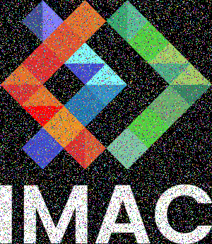|

## Exercice 8 : Rotation de 90°
| Avant         |    Après      |
| ------------- | :-----------: |
|||

## Exercice 9 : RGB split
| Avant         |    Test 1     |    Test 2    |
| ------------- | :-----------: | :-----------:|
||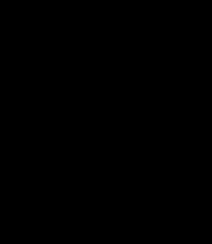|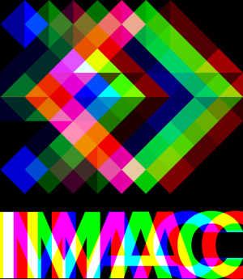|

Pour cet exercice, j'ai eu une erreur sur les bords de l'image, car les pixels à `x - shift` et `x + shift` n'existent pas. J'ai donc limité les colonnes à l'intervalle de l'image (entre 0 et `width - 1`).

## Exercice 10 : Luminosité
| Avant         |    Dark     |    Light    |
| ------------- | :-----------: | :-----------:|
||||

## Exercice 11 : Disque
|    Résultat      |
| :-----------: |
||

## Exercice 12 : Cercle
|    Résultat      |
| :-----------: |
|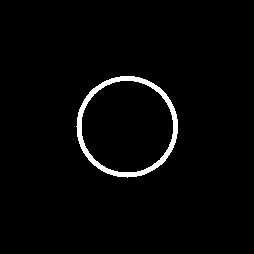|

## Exercice 13 : Animation
|    Résultat      |
| :-----------: |
|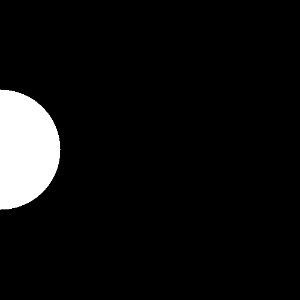|

## Exercice 14 : Rosace
|    Résultat      |
| :-----------: |
|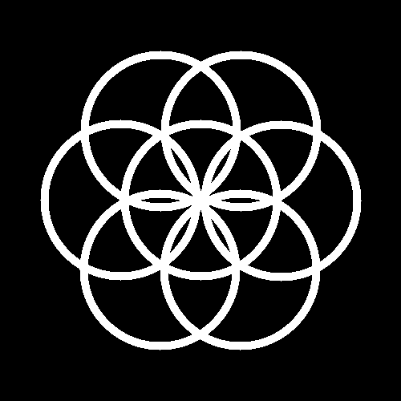|

## Exercice 15 : Mosaïque
| Avant         |    Après      |
| ------------- | :-----------: |
||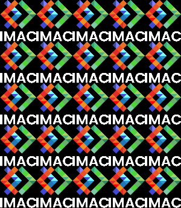|

## Exercice 16 : Glitch
| Avant         |    Après      |
| ------------- | :-----------: |
|||

## Exercice 17 : Tri de pixels
| Numéro 1         |    Numéro 2      | Numéro 3 |
| ------------- | :-----------: | :-----------: |
|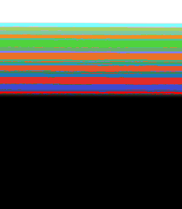|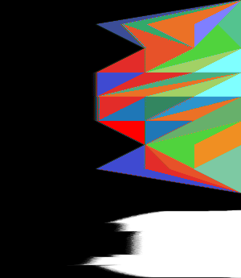| 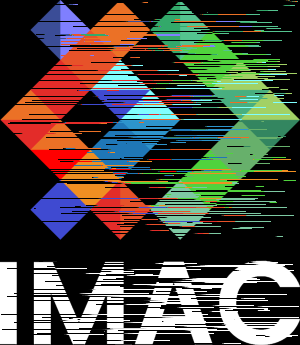|

## Exercice 18 : Fractale de Mandelbrot
|    Résultat      |
| :-----------: |
|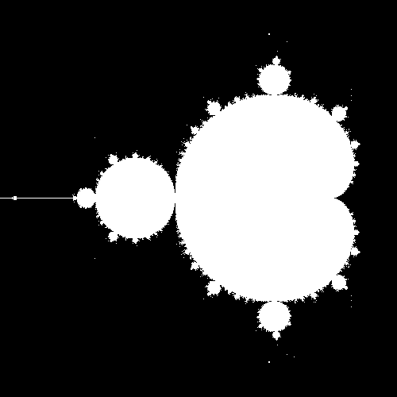|